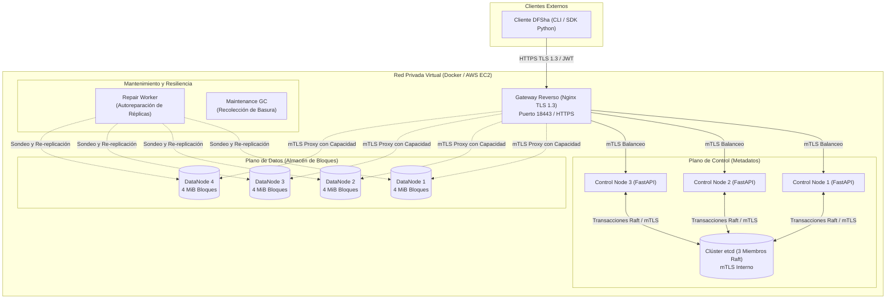

# DFSha — Sistema de Archivos Distribuido (DFS)
### Alta Disponibilidad, Rendimiento, Replicación y Seguridad

[](docs/INFORME_TECNICO_FINAL_DFSha.md)
[](tests/)
[](dfsha/security.py)
[-orange.svg)](docs/DFSha_Fase2_Matriz_y_Decisiones_v2.docx)
[](docs/GUIA_DESPLIEGUE_AWS.md)

**DFSha** es una implementación de un sistema de archivos distribuido de nivel de producción desarrollado para la asignatura **Sistemas Distribuidos (2026-2)**. El sistema permite almacenar, gestionar y acceder concurrentemente a archivos grandes (probado con archivos de 1 GiB) distribuyendo sus bloques y réplicas entre múltiples nodos independientes, garantizando alta disponibilidad, consistencia y cifrado de extremo a extremo.

---

## 🏛️ Arquitectura del Sistema

El sistema implementa la **Opción 1: Cliente/Servidor con Servicio Distribuido entre Servidores (S2S)** operando en una red privada virtual, con separación estricta entre el **Plano de Control** (metadatos) y el **Plano de Datos** (transferencia de bloques) para eliminar cuellos de botella.



### Componentes Principales:
1. **Gateway Reverso (Nginx):** Único punto de contacto público (cumple **RNF7: Transparencia de localización**). Termina TLS 1.3 y enruta el tráfico hacia el plano de control o plano de datos mediante mTLS interno.
2. **Control Nodes (CN1, CN2, CN3):** Servidores FastAPI sin estado. Gestionan el espacio de nombres (RF1), calculan la colocación de bloques mediante **Hashing de Rendezvous** y ejecutan transacciones atómicas Compare-And-Swap (CAS) en `etcd`.
3. **DataNodes (DN1, DN2, DN3, DN4):** Almacenes de objetos puros basados en disco. Reciben bloques cifrados inmutables identificados por su hash SHA-256 (`block_id`) y validan tokens de capacidad firmados.
4. **Clúster etcd:** 3 nodos coordinados con el algoritmo Raft bajo mTLS. Garantizan linealizabilidad y persistencia transaccional de metadatos.
5. **Repair Worker:** Servicio en segundo plano que sondea periódicamente la salud de los bloques y restaura automáticamente el quórum de réplicas ($R=3$) ante fallos de nodos.
6. **Maintenance GC:** Recolector de basura en ventana de mantenimiento con retención segura de 2 horas.

---

## ✨ Requisitos Implementados

| Requisito | Funcionalidad | Implementación |
| :--- | :--- | :--- |
| **RF1** | Espacio jerárquico aislado | Comandos `ls`, `cd`, `mkdir`, `rmdir`, `rm`. Cada usuario autenticado posee un espacio lógico propio protegido por JWT. |
| **RF2** | Transferencia completa | Comandos `put` y `get`. Particionamiento automático en bloques de 4 MiB, cifrado cliente y reensamblado validado por hash. |
| **RF3** | Acceso y sesiones a archivos | Primitivas `open`, `close`, `read`, `write`, `seek`, `abort`. Semántica *close-to-open*. Modificación parcial por bloque y **coordinación optimista por versiones (CAS)**: fusión automática de bloques disjuntos y rechazo `409 Conflict` si dos clientes colisionan en el mismo bloque. |
| **RNF1** | Escalabilidad | Particionado horizontal; separación de planos; hasta 512 bloques por archivo (2 GiB) y probados 1 GiB continuos. |
| **RNF2** | Alta disponibilidad | Replicación quórum $W=2, R=3$; tolerancia a caída de nodos sin interrumpir lecturas ni escrituras; autoreparación asíncrona. |
| **RNF3** | Consistencia y réplicas | Manifiestos versionados atómicamente en `etcd`; recibos firmados por DataNode; validación criptográfica GCM. |
| **RNF4** | Particionamiento multi-nodo | Distribución determinista de bloques mediante Hashing de Rendezvous en los 4 DataNodes. |
| **RNF5** | Concurrencia y rendimiento | Pruebas de estrés concurrentes con múltiples clientes en lecturas y escrituras disjuntas. |
| **RNF6** | Seguridad integral | **Tránsito:** TLS 1.3 (Gateway) + mTLS mutuo entre todos los nodos internos. **Reposo:** AES-256-GCM por bloque en el cliente. Autenticación JWT y tokens de capacidad HMAC efímeros (60 s). |
| **RNF7** | Transparencia de localización | El cliente solo conoce la URL del Gateway (`https://gateway:18443`); no existen IPs de DataNodes cableadas en el cliente. |

---

## 📁 Estructura del Repositorio

```text
DFSha/
├── dfsha/                     # Módulo principal del sistema
│   ├── api.py                 # API REST del plano de control (FastAPI)
│   ├── blocks.py              # Operaciones criptográficas (AES-GCM, SHA-256, HMAC)
│   ├── client.py              # Cliente SDK (RF1, RF2, RF3)
│   ├── datanode.py            # Servidor de bloques de datos
│   ├── gc.py                  # Recolector de basura y retención
│   ├── repair.py              # Monitor de autoreparación de réplicas
│   ├── security.py            # Contextos TLS/mTLS y autenticación JWT
│   ├── sessions.py            # Manejo de sesiones locales close-to-open
│   └── store.py               # Adaptador transaccional para etcd
├── docs/                      # Documentación y entregables
│   ├── INFORME_TECNICO_FINAL_DFSha.md   # Informe técnico final completo
│   ├── INFORME_TECNICO_FINAL_DFSha.docx # Versión Word oficial del informe
│   ├── GUIA_DESPLIEGUE_AWS.md           # Guía de despliegue en AWS Academy
│   └── DFSha_Fase2_Matriz_y_Decisiones_v2.docx # Matriz de decisiones de Fase 2
├── evidencias/                # Evidencias experimentales y benchmarks
│   ├── full.json              # Validación de archivo de 1 GiB y mTLS
│   ├── benchmark-normal.csv   # Benchmark en Docker local (estado normal)
│   ├── benchmark-degradado.csv# Benchmark en Docker local (dn1 caído)
│   ├── benchmark-aws-normal.csv   # Benchmark real sobre AWS EC2 (normal)
│   └── benchmark-aws-degradado.csv# Benchmark real sobre AWS EC2 (degradado)
├── scripts/                   # Automatizaciones y herramientas
│   ├── benchmark.py           # Generador de mediciones de throughput y latencia
│   ├── deploy_aws.sh          # Despliegue desatendido en AWS EC2 (Ubuntu)
│   ├── setup_aws_pki.py       # Generador de certificados con SAN dinámico para AWS
│   ├── setup_secure.py        # Generador de PKI local
│   └── verificar_puntos_1_a_5.ps1 # Suite integral de validación local
├── tests/                     # Suite de 48 pruebas unitarias e integradas
│   ├── test_api.py            # Pruebas de API y directorio
│   ├── test_block_merge.py    # Fusión concurrente y conflictos CAS
│   ├── test_etcd_adapter.py   # Atomicidad y failover de etcd
│   ├── test_repair.py         # Detección y re-replicación ante fallos
│   ├── test_security.py       # mTLS, TLS 1.3 y rechazo sin certificado
│   ├── test_sessions.py       # Semántica RF3 (close, seek, abort)
│   └── test_transfers.py      # Transferencias particionadas
├── compose.yaml               # Orquestación de los 11 contenedores
├── Dockerfile                 # Imagen base Python 3.12 Slim
├── nginx.conf                 # Configuración del Gateway Nginx TLS 1.3
└── requirements.lock          # Dependencias fijadas para reproducibilidad
```

---

## 🚀 Despliegue y Ejecución Rápida

### Prerrequisitos:
- **Docker Desktop** (con soporte para Docker Compose).
- Al menos **8 GiB libres** en el disco para la prueba masiva de 1 GiB.
- PowerShell (Windows) o Bash (Linux / macOS).

---

### Opción 1: Validación Completa en Local (Un Solo Comando)

En Windows PowerShell, ejecuta desde la raíz del proyecto:

```powershell
.\scripts\verificar_puntos_1_a_5.ps1
```

Este script automatizado:
1. Genera los certificados X.509 y claves privadas en `runtime/`.
2. Construye y arranca los 11 contenedores de Docker.
3. Ejecuta las **48 pruebas unitarias e integradas** (`pytest`).
4. Sube y descarga un **archivo de 1 GiB (256 bloques)** verificando su SHA-256.
5. Ejecuta los benchmarks de rendimiento en modo normal y con `dn1` detenido.
6. Ejecuta una recolección de basura controlada y verifica la integridad del almacén.

---

### Opción 2: Despliegue Manual con Docker Compose

```bash
# 1. Generar certificados y secretos locales
python scripts/setup_secure.py

# 2. Levantar el clúster
docker compose up -d --build

# 3. Verificar estado de los servicios
docker compose ps

# 4. Correr la suite de pruebas
docker compose run --rm cn1 pytest tests
```

Acceso a la documentación interactiva Swagger:
👉 **`https://127.0.0.1:18443/docs`** *(requiere la CA de `runtime/trust/ca.crt`)*.

---

### Opción 3: Despliegue en AWS Academy (EC2)

El proyecto incluye soporte nativo para **AWS Academy Learner Lab**:

1. Lanza una instancia EC2 **Ubuntu 24.04 LTS** (`t3.medium`, 30 GB EBS).
2. Abre los puertos **22 (SSH)** y **18443 (HTTPS Gateway)** en el Security Group.
3. Conéctate a la instancia por SSH, clona el repositorio y ejecuta:
   ```bash
   chmod +x scripts/deploy_aws.sh
   ./scripts/deploy_aws.sh
   ```
4. El script detectará automáticamente la IP pública y privada de AWS, generará los certificados con SAN para AWS, levantará los contenedores y dejará el servicio listo en:
   👉 **`https://<IP_PUBLICA_EC2>:18443/docs`**

*(Consulta la [Guía Detallada de AWS](docs/GUIA_DESPLIEGUE_AWS.md) para instrucciones paso a paso).*

---

## 📊 Resultados y Evidencias Experimentales

### 1. Suite de Pruebas Automatizadas
```text
======================= 48 passed, 3 warnings in 12.23s =======================
```
*48 pruebas aprobadas al 100% tanto en local como dentro del clúster desplegado en AWS.*

### 2. Prueba de Carga Masiva (1 GiB)
- **Tamaño:** 1 073 741 824 bytes (1024 MiB).
- **Partición:** 256 bloques de 4 MiB distribuidos uniformemente entre 4 DataNodes.
- **Tiempo de subida (`put`):** 55.38 s (~19.38 MiB/s con cifrado y quórum W=2).
- **Tiempo de descarga (`get`):** 31.06 s (~34.57 MiB/s con descifrado y validación GCM).
- **Verificación criptográfica:** SHA-256 verificado idéntico (`verified: true`).

### 3. Comparativa de Rendimiento (Docker Local vs. AWS Cloud)

| Escenario | Tamaño | Clientes | Docker Local (Round Mediano) | AWS EC2 WAN (Round Mediano) | Observaciones |
| :--- | :---: | :---: | :---: | :---: | :--- |
| **Normal** | 4 MiB | 1 | **0.66 s** | **1.17 s** | Throughput estable; WAN añade latencia RTT y TLS handshake. |
| **Normal** | 4 MiB | 2 | **0.68 s** | **1.66 s** | Excelente paralelismo en clientes concurrentes. |
| **Normal** | 16 MiB | 1 | **1.58 s** | **5.92 s** | Transferencia masiva fluida con $W=2, R=3$. |
| **Normal** | 16 MiB | 2 | **2.21 s** | **6.67 s** | Rendimiento sostenido (~9.4 MiB/s combinados en nube). |
| **Degradado (`dn1` caído)** | 4 MiB | 1 | **0.65 s** | **1.77 s** | Lecturas intactas; quórum de escritura asegurado con los otros 3 DNs. |
| **Degradado (`dn1` caído)** | 16 MiB | 2 | **9.53 s** | **8.35 s** | Mayor dispersión en escrituras por reintento de conexión a `dn1`. |

---

## 🔒 Modelo de Seguridad y Confidencialidad

- **TLS 1.3 en el Perímetro:** Gateway HTTPS público con verificación estricta de certificados.
- **mTLS Interno (Zero-Trust):** Comunicación bidireccionalmente autenticada con certificados X.509 entre ControlNodes, DataNodes y clúster etcd.
- **Cifrado en Reposo (Cliente):** Cada bloque es cifrado por el cliente antes de ser enviado usando **AES-256-GCM**, autenticando la versión del archivo y el índice del bloque en los datos adicionales asociados (AAD).
- **Tokens de Capacidad:** Autorizaciones efímeras (60 segundos) firmadas mediante HMAC para interactuar con DataNodes específicos. Los DataNodes nunca tienen acceso a la clave maestra ni a los datos descifrados.

---

## 👥 Integrantes y Contribuciones

**Equipo de Desarrollo — Sistemas Distribuidos 2026-2:**

- **Mateo Acevedo B.**: Implementación de arquitectura cliente/servidor, orquestación de Docker Compose, despliegue en AWS Academy EC2, infraestructura PKI dinámica y benchmarks WAN.
- **David**: Diseño arquitectónico de colocación por Hashing de Rendezvous, semántica de sesión *close-to-open* y fusión de bloques por versiones.
- **Juan José**: Integración de adaptadores de almacenamiento distribuido etcd, esquemas de autorización JWT y control de concurrencia optimista (CAS).

---

## 📖 Documentación Adicional

- [Informe Técnico Final (Markdown)](docs/INFORME_TECNICO_FINAL_DFSha.md)
- [Informe Técnico Final en Word (DOCX)](docs/INFORME_TECNICO_FINAL_DFSha.docx)
- [Guía de Despliegue en AWS Academy](docs/GUIA_DESPLIEGUE_AWS.md)
- [Matriz Comparativa y Registro de Decisiones Arquitectónicas (ADR)](docs/DFSha_Fase2_Matriz_y_Decisiones_v2.docx)
