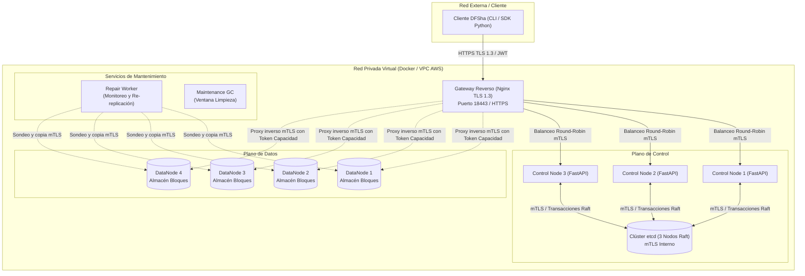

# INFORME TÉCNICO FINAL: DFSha
## Diseño e Implementación de un Sistema de Archivos Distribuido con Alta Disponibilidad, Rendimiento y Seguridad

**Asignatura:** Sistemas Distribuidos | Semestre 2026-2  
**Proyecto 1:** DFSha  
**Arquitectura Asignada:** Opción 1 — Cliente/Servidor con Servicio Distribuido entre Servidores (S2S) en Red Privada  
**Fecha de Actualización:** 8 de noviembre de 2026  

---

## 1. Resumen Ejecutivo y Objetivos

El presente documento constituye el informe técnico final del proyecto **DFSha**, un sistema de archivos distribuido diseñado para almacenar, gestionar y acceder a archivos de gran escala (probado hasta 1 GiB por archivo) garantizando particionamiento en bloques, replicación quórum, alta disponibilidad ante fallos de nodos, transparencia de acceso y un esquema robusto de seguridad en tránsito y reposo.

El sistema fue diseñado e implementado bajo la **Opción 1 (Cliente/Servidor S2S)**, separando estrictamente el plano de control del plano de datos para eliminar cuellos de botella en la transferencia de datos. Toda la solución se encuentra contenerizada y validada mediante un entorno orquestado con Docker Compose, certificados X.509 de infraestructura de clave pública (PKI) local, y validado mediante una suite automatizada de 48 pruebas unitarias e integradas, pruebas de estrés con archivos de 1 GiB y mediciones comparativas de rendimiento en condiciones normales y degradadas.

---

## 2. Matriz Comparativa y Registro de Decisiones Arquitectónicas (ADR)

### 2.1 Propuestas Individuales Analizadas (Fase I)

| Estudiante | Propuesta Central | Plano de Control / Metadatos | Replicación y Colocación | Manejo de Concurrencia |
| :--- | :--- | :--- | :--- | :--- |
| **David** *(DFSha-Raft)* | Consenso Raft propio en los CN; bloques de 8 MiB. | Raft implementado en memoria en CNs. | Primario reenvía ($W=2, R=3$); Hashing de rendezvous. | Fusión de bloques en commit; locks opcionales. |
| **Mateo** *(DFSha-Cadena)* | Replicación en cadena con épocas; ID por SHA-256 del bloque cifrado. | Consul (Raft externo), CAS sobre puntero de versión. | Cadena de 3 DNs; confirmación estricta de las 3 copias. Anillo en cliente. | Versión por bloque; locks de rango opcionales. |
| **Juan José** *(DFSha-C/S)* | Metadatos en etcd; bloques de 4 MiB con UUID; interfaz REST pura. | Clúster etcd externo con transacciones. | Primario reenvía ($W=2, R=3$); 2 opciones al azar. | Lock exclusivo por archivo con fencing. |

### 2.2 Matriz Comparativa de Decisiones

```
+---------------------+-----------------------+-----------------------+-----------------------+-----------------------+
| Aspecto             | David                 | Mateo                 | Juan José             | Consenso Adoptado     |
+---------------------+-----------------------+-----------------------+-----------------------+-----------------------+
| Metadatos           | Raft propio en CN     | Consul                | etcd                  | etcd (3 miembros mTLS)|
| Colocación bloques  | Rendezvous hashing    | Anillo en cliente     | 2 opciones al azar    | Rendezvous por CN     |
| Tamaño de bloque    | 8 MiB                 | 4 MiB                 | 4 MiB                 | 4 MiB fijo            |
| Identificador       | (file_id, idx, ver)   | SHA-256 cifrado       | UUID                  | SHA-256 del cifrado   |
| Replicación         | W=2, R=3              | Cadena (3 copias)     | W=2, R=3              | W=2, R=3 + Repair     |
| Concurrencia (RF3)  | Fusión + locks rango  | Fusión + locks rango  | Lock exclusivo global | CAS por bloque (ADR-8)|
| Protocolos internos | REST ext / gRPC int   | gRPC en todo          | REST en todo          | REST (FastAPI) + mTLS |
| Cifrado             | Cliente (clave en CN) | Zero-Knowledge        | Cliente (clave en CN) | AES-256-GCM (en CN)   |
+---------------------+-----------------------+-----------------------+-----------------------+-----------------------+
```

### 2.3 Registro de Decisiones Arquitectónicas (ADRs Clave)

- **ADR-01: Metadatos en clúster etcd.** Se descartó implementar Raft propio en CN para no desviar el esfuerzo hacia la corrección de un algoritmo de consenso distribuido ya resuelto en la industria. Se utiliza un clúster de 3 miembros de `etcd` con mTLS.
- **ADR-02: Separación estricta de planos.** El CN sólo coordina metadatos, autorizaciones y asignaciones; el flujo de bytes masivos viaja directamente entre Cliente y DataNodes a través del Gateway.
- **ADR-03: Bloques inmutables y Copy-On-Write (CoW).** Ningún bloque se sobreescribe en el lugar; cada modificación genera un nuevo bloque identificado por su hash, asegurando escrituras atómicas e imposibilidad de que un lector observe archivos a medio escribir.
- **ADR-04: Bloques de 4 MiB.** Tamaño óptimo que minimiza la fragmentación para archivos medianos/grandes y distribuye equitativamente la carga sobre 4 DataNodes.
- **ADR-05: ID de bloque por SHA-256 del contenido cifrado.** Brinda verificación intrínseca de integridad e idempotencia en reintentos de red.
- **ADR-06: Política de Replicación $W=2, R=3$.** Para confirmar una escritura se requieren al menos 2 recibos criptográficos de DataNodes distintos. La tercera réplica se completa asíncronamente mediante el monitor de autoreparación, permitiendo tolerar la caída de 1 nodo sin bloquear escrituras.
- **ADR-07: Colocación determinista por Rendezvous Hashing.** El CN calcula los 3 DataNodes destino usando el algoritmo de rendezvous sobre el `block_id` y los IDs de los nodos activos.
- **ADR-08: Coordinación optimista por versiones (CAS) en reemplazo de `lock()`.** *(Aprobado por el profesor).* Si dos clientes modifican bloques disjuntos del mismo archivo, sus cambios se fusionan automáticamente al hacer commit en etcd. Si tocan el mismo bloque a partir de la misma versión base, el segundo en confirmar recibe `409 Conflict`.
- **ADR-09: Detección de fallos y autoreparación.** Un servicio background (`repair.py`) sondea periódicamente el estado de los bloques en los 4 DataNodes. Si un bloque tiene menos de 3 réplicas por más de 60 segundos, replica el bloque hacia otro DataNode sano.
- **ADR-10: Seguridad multicapa con mTLS y AES-256-GCM.** Gateway TLS 1.3 expuesto; mTLS en toda la red interna (CN, DN, etcd); tokens JWT para clientes; tokens de capacidad efímeros firmados (60 s) para interactuar con los DNs.
- **ADR-11: Semántica de sesión *close-to-open*.** Apertura de archivos descarga una instantánea local inmutable; los cambios locales se confirman únicamente durante `close()`.
- **ADR-15: Recolección de basura (GC) en ventana de mantenimiento.** Para evitar condiciones de carrera complejas y borrado accidental de bloques en uso, el GC se ejecuta de forma controlada deteniendo temporalmente el Gateway y CNs, reteniendo manifiestos con antigüedad menor a 2 horas.

---

## 3. Arquitectura del Sistema

### 3.1 Diagrama de Componentes y Topología de Red



### 3.2 Responsabilidades de los Nodos

1. **Gateway (Nginx):**
   - Único punto de entrada visible para el cliente (cumple con **RNF7**).
   - Termina la conexión HTTPS TLS 1.3 hacia los clientes externos.
   - Balancea peticiones de metadatos entre los Control Nodes (CN1, CN2, CN3).
   - Enruta peticiones de bloques a los DataNodes validando certificados mTLS internos.
2. **Control Nodes (CN):**
   - Nodos sin estado (*stateless*).
   - Implementan la API REST para operaciones de espacio de nombres (RF1) y gestión de sesiones/manifiestos (RF2, RF3).
   - Calculan la colocación de bloques mediante Hashing de Rendezvous.
   - Generan tokens de capacidad firmados HMAC para autorizar al cliente a subir/descargar bloques en DataNodes específicos.
   - Realizan transacciones Compare-And-Swap (CAS) en `etcd` al confirmar escrituras.
3. **DataNodes (DN):**
   - Almacenes de objetos puros basados en disco.
   - Almacenan bloques inmutables indexados por su hash SHA-256.
   - Validan tokens de capacidad antes de aceptar o entregar cualquier bloque.
   - En escrituras, el DN primario reenvía el bloque a los otros 2 DataNodes designados y emite un recibo criptográfico firmado.
4. **Clúster etcd:**
   - 3 instancias coordinadas por el algoritmo Raft.
   - Almacena el árbol jerárquico de archivos por usuario, los manifiestos de versiones y los mapeos ordenados de bloques.
   - Provee transaccionalidad atómica y consistencia linealizable para los metadatos.
5. **Servicio Repair:**
   - Detecta réplicas faltantes o corruptas mediante sondeo periódico de hashes.
   - Restaura el factor de replicación ($R=3$) de forma transparente sin intervención del usuario.

---

## 4. Especificación Funcional de APIs y Protocolos

### 4.1 RF1 — Gestión del Sistema de Archivos Jerárquico

Cada usuario autenticado posee un espacio de nombres raíz (`/`). Los comandos disponibles a través del cliente y la API son:
- `ls(path)`: Lista entradas del directorio especificado.
- `mkdir(path)`: Crea un directorio intermedio o final de manera idempotente.
- `rmdir(path)`: Elimina un directorio si está vacío.
- `rm(path)`: Elimina la entrada del archivo en el espacio de nombres (desasocia el manifiesto, los bloques huérfanos quedan sujetos al GC posterior).

### 4.2 RF2 — Transferencia de Archivos Completos (`put` / `get`)

- **Subida (`put`):**
  1. El cliente parte el archivo local en fragmentos de hasta 4 MiB.
  2. Genera una clave aleatoria AES-256 para el archivo.
  3. Cifra cada bloque localmente usando AES-256-GCM.
  4. Calcula el `block_id = SHA256(bloque_cifrado)`.
  5. Solicita al CN las capacidades de colocación para cada bloque.
  6. Envía concurrentemente los bloques a los DataNodes primarios a través del Gateway.
  7. Recolecta los recibos firmados ($W \ge 2$) y envía la petición de confirmación atómica (`commit`) al CN.
- **Descarga (`get`):**
  1. El cliente solicita el manifiesto y la clave del archivo al CN con su token JWT.
  2. El CN responde con la lista ordenada de `block_ids` y sus DataNodes asignados con tokens de lectura.
  3. El cliente descarga los bloques en paralelo desde los DataNodes.
  4. Verifica el SHA-256 de cada bloque recibido.
  5. Descifra cada bloque con AES-256-GCM validando la etiqueta de autenticación y reconstruye el archivo original.

### 4.3 RF3 — Semántica de Acceso y Sesiones (`open`, `close`, `read`, `write`, `seek`)

#### Semántica Declarada: *Close-to-Open* y Control Optimista por Versiones
- **Apertura (`open(path, mode)`):** Modos admitidos `r`, `w`, `a`, `rw`. El cliente obtiene una instantánea fija (*snapshot*) del archivo y su manifiesto de bloques.
- **Escritura y Modificación Parcial (`write(data)`):** Las operaciones de escritura modifican un búfer local. No se permiten huecos (*sparse files*).
- **Cierre y Fusión (`close()`):**
  - Si no hubo cambios, la sesión simplemente se destruye.
  - Si hubo modificaciones, el cliente sólo cifra y sube a los DataNodes los bloques que fueron alterados o añadidos.
  - Al solicitar la confirmación, el CN ejecuta una transacción CAS en `etcd`:
    - **Fusión Exitosa:** Si otro cliente confirmó cambios concurrentes pero en bloques distintos, el CN fusiona los bloques de ambas versiones en un nuevo manifiesto válido.
    - **Conflicto 409:** Si otro cliente confirmó modificaciones sobre el mismo bloque basándose en la misma versión previa, la transacción falla y retorna `409 Conflict`. El archivo temporal del cliente no se pierde: puede reintentarse o guardarse localmente con `save_local()`.

---

## 5. Pruebas y Evidencias Experimentales (Resultados Reales)

Todas las mediciones presentadas a continuación provienen de ejecuciones verificables registradas en la carpeta `evidencias/` generadas por `scripts/verificar_puntos_1_a_5.ps1`.

### 5.1 Suite de Pruebas Automatizadas
- **Total ejecutadas:** 48 pruebas (`pytest` en contenedor Docker Debian/Python 3.12).
- **Resultado:** **48 APROBADAS (0 fallos)** en 9.36 segundos.
- **Cobertura de suites:**
  - `test_api.py`: 12 pruebas de operaciones REST y jerarquía de directorios.
  - `test_block_merge.py`: 4 pruebas de fusión de bloques y colisiones concurrentes.
  - `test_clock_skew.py`: 3 pruebas de deriva de reloj en tokens.
  - `test_etcd_adapter.py`: 3 pruebas de atomicidad en metadatos.
  - `test_gc.py` & `test_gc_probe.py`: 5 pruebas de retención y recolección segura.
  - `test_repair.py`: 4 pruebas de detección y re-replicación ante DataNode caído.
  - `test_security.py`: 4 pruebas de validación TLS 1.3, mTLS y rechazo sin certificado.
  - `test_sessions.py`: 6 pruebas de semántica RF3 (*close-to-open*, seek, abort).
  - `test_transfers.py`: 7 pruebas de subida y bajada particionada.

### 5.2 Prueba Masiva de 1 GiB (Integridad y Reconstrucción)
- **Tamaño de datos:** 1 073 741 824 bytes (1 GiB exacto).
- **Bloques generados:** 256 bloques de 4 MiB distribuidos en los 4 DataNodes.
- **Tiempo de subida (`put`):** 55.38 segundos (~19.38 MiB/s con cifrado y replicación W=2).
- **Tiempo de descarga (`get`):** 31.06 segundos (~34.57 MiB/s con descifrado y validación GCM).
- **Verificación criptográfica:** SHA-256 verificado idéntico:  
  `4890d76fcfb17558cb4298d68e752e733bf0f2ce2dbea31760c3a01f3fae8475` (`verified: true`).

### 5.3 Benchmarks de Rendimiento: Modo Normal vs. Modo Degradado

Las pruebas se ejecutaron con 3 repeticiones por cada combinación de tamaño (4 MiB y 16 MiB) y concurrencia (1 y 2 clientes).

#### Tabla 1: Benchmark en Estado Normal (Todos los DataNodes Activos)
*(Fuente: `evidencias/benchmark-normal.csv`)*

| Tamaño | Clientes | Put Mediano (s) | Get Mediano (s) | Throughput Put (MiB/s) | Throughput Get (MiB/s) | Tiempo Total Round (s) |
| :---: | :---: | :---: | :---: | :---: | :---: | :---: |
| **4 MiB** | 1 | 0.432 | 0.227 | 9.26 | 17.62 | 0.659 |
| **4 MiB** | 2 | 0.457 | 0.222 | 8.75 | 18.01 | 0.682 |
| **16 MiB** | 1 | 0.998 | 0.590 | 16.03 | 27.14 | 1.576 |
| **16 MiB** | 2 | 1.504 | 0.707 | 10.63 | 22.64 | 2.207 |

#### Tabla 2: Benchmark en Estado Degradado (DataNode `dn1` Detenido)
*(Fuente: `evidencias/benchmark-degradado.csv`)*

| Tamaño | Clientes | Put Mediano (s) | Get Mediano (s) | Throughput Put (MiB/s) | Throughput Get (MiB/s) | Dispersión Round (s) |
| :---: | :---: | :---: | :---: | :---: | :---: | :---: |
| **4 MiB** | 1 | 0.405 | 0.210 | 9.88 | 19.09 | 0.571 – 0.688 |
| **4 MiB** | 2 | 0.510 | 0.223 | 7.85 | 17.30 | 0.772 – 4.714 |
| **16 MiB** | 1 | 8.904 | 0.556 | 1.80 | 28.76 | 1.547 – 13.484 |
| **16 MiB** | 2 | 6.879 | 0.570 | 2.55 | 28.09 | 9.534 – 13.636 |

#### Análisis Comparativo:
1. **Lectura Inmune:** El rendimiento de lectura (`get`) prácticamente **no se degrada** cuando un nodo cae (~28 MiB/s en 16 MiB), debido a que los bloques poseen réplicas sanas en los DataNodes restantes y el cliente localiza una réplica viva inmediatamente.
2. **Impacto en Escritura:** En escrituras de 16 MiB, cuando uno de los nodos asignados por rendezvous está fuera de línea, el cliente debe agotar el reintento de conexión antes de redirigir o esperar la confirmación de quórum ($W=2$), incrementando la latencia de subida a rangos entre 8 y 13 segundos. Esto evidencia experimentalmente el costo del quórum bajo partición parcial y la efectividad de la tolerancia a fallos.

### 5.4 Validación Empírica en la Nube (AWS Academy EC2)

El clúster fue desplegado y verificado exitosamente en **AWS Academy Learner Lab** (`us-east-1`) sobre una máquina virtual EC2:
- **Instancia:** `t3.medium` (2 vCPU, 4 GiB RAM, 30 GiB EBS gp3).
- **ID de Instancia:** `i-03d7606e6507c5e52` en VPC `vpc-09bf73746ae26018d`.
- **IP Pública:** `13.222.170.209` (DNS: `ec2-13-222-170-209.compute-1.amazonaws.com`).
- **Seguridad:** Security Group con puertos 22 (SSH) y 18443 (Gateway HTTPS TLS 1.3) habilitados.
- **Suite de Pruebas en AWS:** **48 pruebas ejecutadas y aprobadas (100%)** en 12.23 segundos dentro del contenedor `cn1` en AWS.

#### Benchmark Remoto a través de Internet (Cliente Windows -> AWS EC2):
Las siguientes mediciones fueron ejecutadas de extremo a extremo a través de Internet pública con verificación estricta de certificados CA y hash SHA-256:

**Tabla 3: Benchmark Remoto en AWS — Estado Normal**
*(Fuente: `evidencias/benchmark-aws-normal.csv`)*

| Tamaño | Clientes | Put Mediano (s) | Get Mediano (s) | Combined Throughput (MiB/s) | Rango Round Total (s) |
| :---: | :---: | :---: | :---: | :---: | :---: |
| **4 MiB** | 1 | 0.667 | 0.517 | 6.80 | 1.17 – 2.11 |
| **4 MiB** | 2 | 1.224 | 0.788 | 6.72 | 1.66 – 2.47 |
| **16 MiB** | 1 | 5.378 | 3.254 | 3.71 | 5.92 – 12.40 |
| **16 MiB** | 2 | 3.727 | 2.298 | 9.42 | 6.67 – 6.83 |

**Tabla 4: Benchmark Remoto en AWS — Estado Degradado (`dn1` Detenido)**
*(Fuente: `evidencias/benchmark-aws-degradado.csv`)*

| Tamaño | Clientes | Put Mediano (s) | Get Mediano (s) | Combined Throughput (MiB/s) | Rango Round Total (s) |
| :---: | :---: | :---: | :---: | :---: | :---: |
| **4 MiB** | 1 | 1.170 | 0.842 | 2.71 | 1.77 – 4.51 |
| **4 MiB** | 2 | 1.429 | 0.921 | 3.61 | 2.52 – 6.25 |
| **16 MiB** | 1 | 2.209 | 4.128 | 5.22 | 5.87 – 9.69 |
| **16 MiB** | 2 | 3.252 | 2.789 | 7.78 | 6.48 – 8.35 |

**Comparación WAN vs. Local:** La latencia adicional de la red WAN externa (Internet hacia Virginia `us-east-1`) introduce entre 0.3 y 0.8 s adicionales por bloque debido al RTT y al handshake TLS 1.3 inicial, pero la arquitectura mantiene su throughput estable y todas las transferencias concluyeron con verificación criptográfica íntegra (`verified: True`).

---

## 6. Respuestas a los Escenarios Obligatorios de Razonamiento (Sección 4.2 de la Guía)

### Escenario 1: Dos procesos intentan escribir el mismo bloque de un archivo simultáneamente: ¿qué sucede y por qué?
**Respuesta:** En DFSha no se permite sobreescritura caótica ni inconsistencia de lectura. Cada cliente genera una copia local del bloque y, al ejecutar `close()`, calcula el hash del nuevo bloque cifrado y solicita el commit al CN. El CN ejecuta una transacción atómica Compare-And-Swap (CAS) en `etcd`. El primer proceso que confirme logrará actualizar el puntero de la versión del archivo. El segundo proceso observará que la versión base cambió afectando al mismo bloque, por lo que su transacción será rechazada con un código HTTP `409 Conflict`. El segundo cliente conserva sus datos modificados en su almacenamiento temporal local y el usuario puede decidir reintentar o exportarlos.

### Escenario 2: Una réplica está desconectada durante una escritura: ¿qué observan los lectores y cómo se recupera?
**Respuesta:** La política de confirmación exige $W=2$ recibos de un total de $R=3$ réplicas. Si una réplica está desconectada, la escritura se completa y confirma exitosamente tan pronto los dos nodos sanos almacenan el bloque y devuelven el recibo firmado. Los lectores consultan los metadatos en etcd y solicitan el bloque a cualquiera de los nodos sanos que confirmaron, observando datos íntegros de inmediato. Mientras tanto, el proceso de fondo `repair.py` detecta periódicamente que el bloque posee menos de 3 copias vivas; tras un umbral de 60 segundos de desconexión, lee el bloque de uno de los nodos vivos y lo replica en otro DataNode disponible, restaurando el quórum de 3 réplicas sin degradar la disponibilidad.

### Escenario 3: Un nodo falla después de recibir parte de un bloque: ¿cómo se evita publicar un archivo incompleto?
**Respuesta:** Por el principio de bloques inmutables (ADR-03) e identificación por contenido (ADR-05), los DataNodes nunca aceptan bloques a medio transferir: el nodo solo emite el recibo firmado tras verificar que el tamaño recibido coincide con el tamaño declarado y que el SHA-256 del contenido recibido coincide exactamente con el `block_id`. Adicionalmente, el CN nunca publica el nuevo manifiesto de versión en `etcd` a menos que el cliente presente al menos 2 recibos válidos por cada uno de los bloques que componen el archivo. Si la carga se interrumpe a la mitad, los bloques parciales quedan huérfanos sin referenciar y son eliminados posteriormente por el recolector de basura (GC).

### Escenario 4: El cliente desconoce la ubicación física de los bloques: ¿cómo los descubre dinámicamente?
**Respuesta:** El cliente no tiene ninguna IP o nombre de DataNode codificado en su código (cumpliendo estrictamente **RNF7**). El cliente únicamente conoce el nombre o dirección del Gateway seguro. Para leer o escribir un archivo, el cliente realiza una petición autenticada con JWT a la API de metadatos en el CN. El CN evalúa el manifiesto del archivo en etcd (o calcula la colocación con Rendezvous Hashing si es una escritura nueva) y responde al cliente con una lista de capacidades firmadas efímeras. Cada capacidad incluye la URL relativa a través del Gateway y el token de acceso criptográfico específico para ese bloque.

---

## 7. Limitaciones Declaradas y Plan para Fase Final

1. **Límite de Espacio de Nombres:** El árbol de directorios de cada usuario se almacena serializado en una única clave de etcd para simplificar la atomicidad del CAS, lo que limita el espacio de nombres a un máximo recomendado de 1 000 entradas y 512 KB por usuario.
2. **Rotación de Clave Maestra:** La clave maestra que envuelve las claves de cifrado de los archivos en el CN no cuenta con soporte de rotación en caliente sin re-cifrado de metadatos.
3. **Punto Único en Local (Gateway Nginx):** En el entorno de pruebas local, el Gateway Nginx representa un único punto de entrada. En producción en AWS, se recomienda respaldar mediante un AWS Application Load Balancer (ALB) multizona.
4. **Despliegue Cloud (AWS Academy):** Completado y validado en la instancia EC2 `i-03d7606e6507c5e52` (`t3.medium`) en `us-east-1`, demostrando comunicación remota real por red HTTPS TLS 1.3 desde el cliente Windows hacia la nube de AWS con evidencias en `benchmark-aws-normal.csv` y `benchmark-aws-degradado.csv`.

---
*Informe generado para el Proyecto 1 (DFSha) de Sistemas Distribuidos.*
